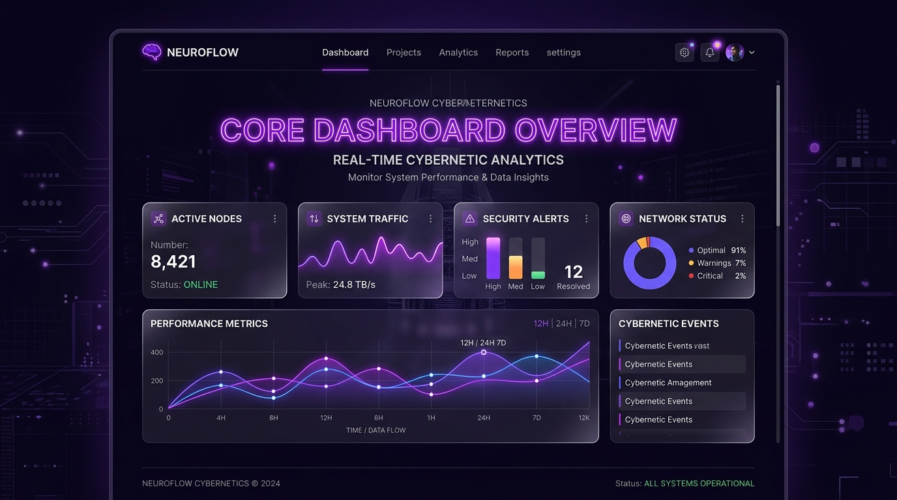

# 🌌 NeuroFlow — Next-Gen Autonomous Intelligence Platform

[](https://developer.mozilla.org/en-US/docs/Web/HTML)
[](https://developer.mozilla.org/en-US/docs/Web/CSS)
[](https://developer.mozilla.org/en-US/docs/Web/JavaScript)
[](https://coolors.co/5f1e9f)
[](LICENSE)

> A modern, responsive, high-performance landing page engineered using **strictly semantic HTML5, pure CSS3, and vanilla JavaScript**. Built around an imperial violet theme centered on **`#5F1E9F`**, featuring glassmorphism, dynamic 3D card physics, viewport counter animations, and accessible client-side form validation.

---

## 📸 Interface Preview



---

## ✨ Features & Architecture

### 1. 🚀 Hero Section
- **Dynamic Visual Hierarchy**: Impactful typography powered by Google Fonts (`Outfit` & `Plus Jakarta Sans`) with fluid sizing (`clamp()`).
- **Cybernetic Dashboard Showcase**: Visual preview container with layered glassmorphism, floating live telemetry badges (*Status: Online*, *24.8 TB/s Traffic*), and radial ambient illumination.
- **Micro-Badges & Action CTAs**: Primary action button featuring linear gradient elevation, glow pulse, and secondary glass border button.

### 2. 🧬 About Section
- **Narrative & Value Pillars**: Highlighting the platform's vision, global edge distribution, and compliance standards.
- **Interactive Viewport Counters**: Four telemetry metrics (`99.99% SLA`, `< 15ms Latency`, `10M+ Daily Events`, `250+ Enterprise Partners`) that automatically animate upwards using `IntersectionObserver` when scrolled into view.

### 3. ⚡ Features Section (3 Interactive Cards)
Crafted with interactive 3D perspective tilt and dynamic cursor light tracking on mousemove:
1. **Sub-Millisecond Edge Architecture**: Distributed mesh network with anycast smart routing and automated cold-start suppression.
2. **Adaptive Cognitive Automation**: Self-optimizing deep learning heuristics, predictive elasticity, and zero-downtime self-healing.
3. **Fortified Zero-Trust Cryptography**: Institutional-grade AES-256-GCM hardware key isolation, tamper-evident audit logs, and SOC2/GDPR compliance.

### 4. 📬 Contact Section
- **Dual-Column Layout**: Direct inquiries channel, global headquarters address, and developer community links.
- **Accessible Client-Side Form**:
  - Name, work email, subject inquiry dropdown, and multi-line message fields.
  - Real-time error state detection and accessible ARIA alert messaging (`role="alert"`).
  - Simulated asynchronous transmission state with animated spinner.
  - Elegant success confirmation screen with a "Send Another Message" reset button.

---

## 🎨 Color Palette & Theme Tokens

The entire design system is anchored around the brand color **`#5F1E9F`**:

| Role | Color Hex | Sample | Description |
| :--- | :--- | :---: | :--- |
| **Primary Theme** | `#5F1E9F` | `■` | Core imperial violet theme color |
| **Primary Light** | `#8A38E8` | `■` | Gradient starting point & active accents |
| **Primary Lighter** | `#A855F7` | `■` | Icon borders & high-visibility highlights |
| **Accent Glow** | `#C084FC` | `■` | Glow effects, pulse badges, and links |
| **Soft Highlight** | `#E9D5FF` | `■` | Subtle badge text and monogram nodes |
| **Electric Cyan** | `#38BDF8` | `■` | Secondary complementary data points |
| **Dark Canvas** | `#080312` | `■` | Deep obsidian background |
| **Card Surface** | `rgba(23, 10, 42, 0.72)` | `■` | Glassmorphic background with blur |

---

## 📁 Repository Structure

```text
future-project-landing/
├── index.html              # Fully semantic HTML5 document
├── css/
│   └── style.css           # Vanilla CSS design system & responsive rules
├── js/
│   └── script.js           # Vanilla JS: sticky nav, tilt effect, counters & form logic
├── assets/
│   ├── favicon.svg         # Stylized vector brand favicon
│   └── dashboard-preview.jpg # High-resolution hero dashboard asset
└── README.md               # GitHub documentation
```

---

## 🚀 Getting Started

No node modules, build tools, or compilers are required. Everything runs out of the box in any modern web browser.

### Option 1: Direct File Launch
Simply double-click `index.html` or open it with your web browser:
```bash
# Windows
start index.html

# macOS
open index.html

# Linux
xdg-open index.html
```

### Option 2: Local Development Server (Recommended)
Using Python's built-in web server:
```bash
# Python 3
python -m http.server 8080

# Then open in your browser:
http://localhost:8080
```

Using Node.js `npx serve`:
```bash
npx serve .
```

Using VS Code **Live Server** extension:
1. Open the folder in VS Code.
2. Right-click `index.html` and select **"Open with Live Server"**.

---

## 🌐 Deploying to GitHub Pages

You can publish this landing page for free using GitHub Pages in under a minute:

1. Initialize git and commit the files:
   ```bash
   git init
   git add .
   git commit -m "Initial commit: NeuroFlow modern landing page"
   ```
2. Create a new repository on [GitHub](https://github.com/new).
3. Link and push your local code:
   ```bash
   git remote add origin https://github.com/<your-username>/<repo-name>.git
   git branch -M main
   git push -u origin main
   ```
4. On GitHub, navigate to **Settings** > **Pages**.
5. Under **Branch**, select `main` and `/ (root)`, then click **Save**.
6. Your site will be live at `https://<your-username>.github.io/<repo-name>/`!

---

## ♿ Accessibility (a11y) & SEO Standards

- **Semantic Landmark Elements**: `<header>`, `<nav>`, `<main>`, `<section>`, `<article>`, `<footer>`, `<figure>`, `<figcaption>`.
- **Keyboard Navigation**: Accessible skip-to-content link (`#skip-link`), visible focus outlines (`:focus-visible`), and Escape key mobile drawer closing.
- **ARIA Attributes**: `aria-expanded`, `aria-controls`, `aria-labelledby`, `aria-describedby`, and `role="alert"` for real-time validation.
- **Reduced Motion Support**: Honoring user OS preferences via `@media (prefers-reduced-motion: reduce)`.
- **SEO & Social Optimization**: Open Graph tags, descriptive meta descriptions, thematic color meta tag, and structured heading hierarchy (`h1` -> `h2` -> `h3`).

---

## 📄 License

This project is licensed under the [MIT License](LICENSE) — free for personal and commercial usage.
